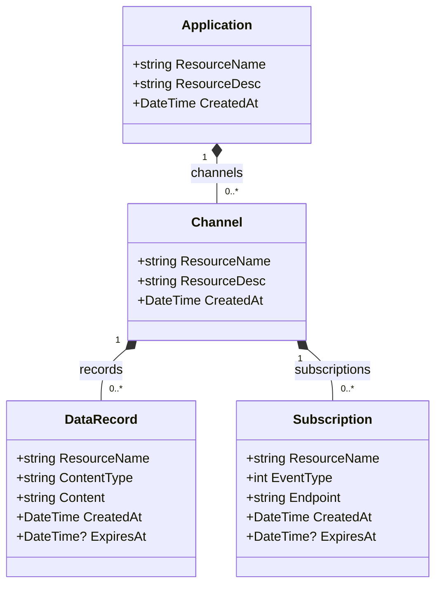

# 01 — Modelo de domínio (sem serviços)

**Estado: [PROPOSTA], não implementação.**

**Origem:** §2 do enunciado. Os quatro tipos têm nomes públicos exatos `application`, `channel`, `data-record` e `subscription`. Aqui só aparecem **entidades de domínio**, não Controllers/Services/DTOs/IDs SQLite. Os nomes PascalCase são internos ao código; `res-type` é propriedade do contrato JSON e não exige uma coluna SQL por entidade.

**Cardinalidade:** foi modelado `0..*` em canais para permitir a criação atómica de uma application ainda sem canais, enquanto o enunciado descreve o estado desejado como 1..N. Esta tensão está registada em Q-18; não esconder o intervalo de configuração.

**Composição:** sugere pertença hierárquica forte, mas **não decide** sozinha a política de cascade delete nem de notificações. Consultar `19-politica-nomes-e-cascatas.md`.
