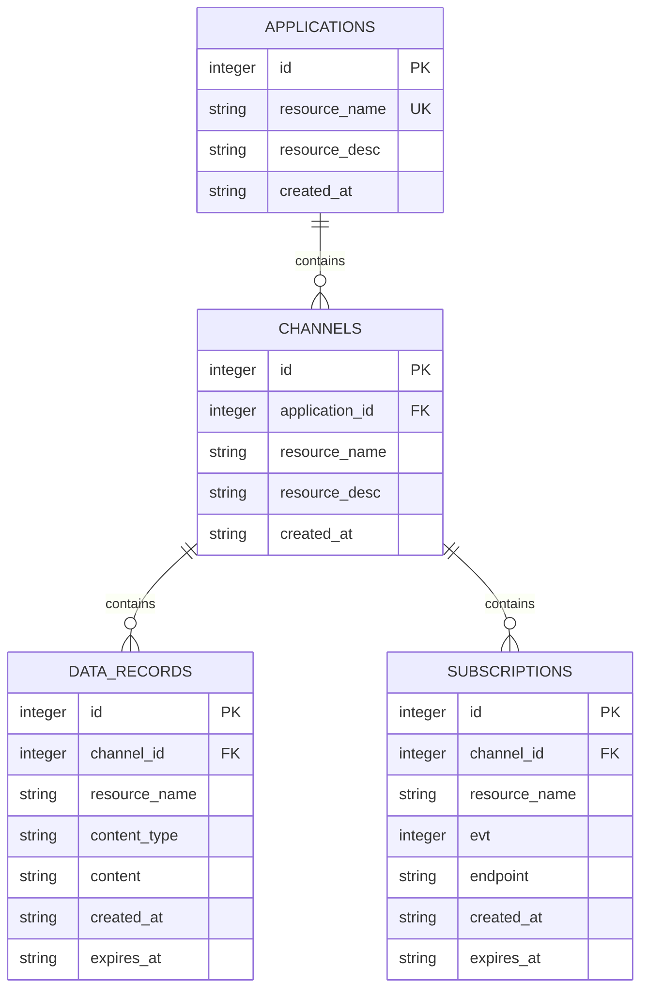

# 02 — Modelo ER SQLite

**Estado: [PROPOSTA], não implementação.**

**Origem:** relações da hierarquia §2. A BD acrescenta PK/FK exclusivamente internas (§2.1). `subs` não existe na BD; é um nó **virtual** da rota. A política provisória v2 proíbe colisões de nomes **entre** `DATA_RECORDS` e `SUBSCRIPTIONS` no mesmo canal, usando triggers (o Mermaid ER não expressa triggers); ver `../../sql/schema.sql`. Os IDs nunca aparecem nos URLs nem no JSON.
