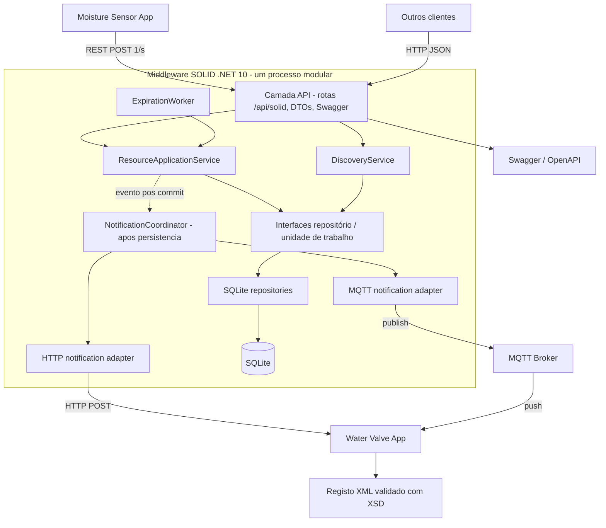

# 03 — Arquitetura de componentes proposta

**Estado: [PROPOSTA], não implementação.**

**Separação:** camada REST trata protocolo/DTO; aplicação orquestra casos de uso; domínio contém invariantes; infraestrutura implementa SQLite e transportes. Aplicações Sensor/Valve são **processos independentes** e só se ligam via SOLID. Não são microserviços internos.

**Nota:** a seta de evento pós-commit exprime ordem lógica, não garante entrega confiável. Uma outbox persistente é apenas uma **alternativa opcional**. Contrato e fiabilidade: `../07-notificacoes-e-expiracao.md`.
