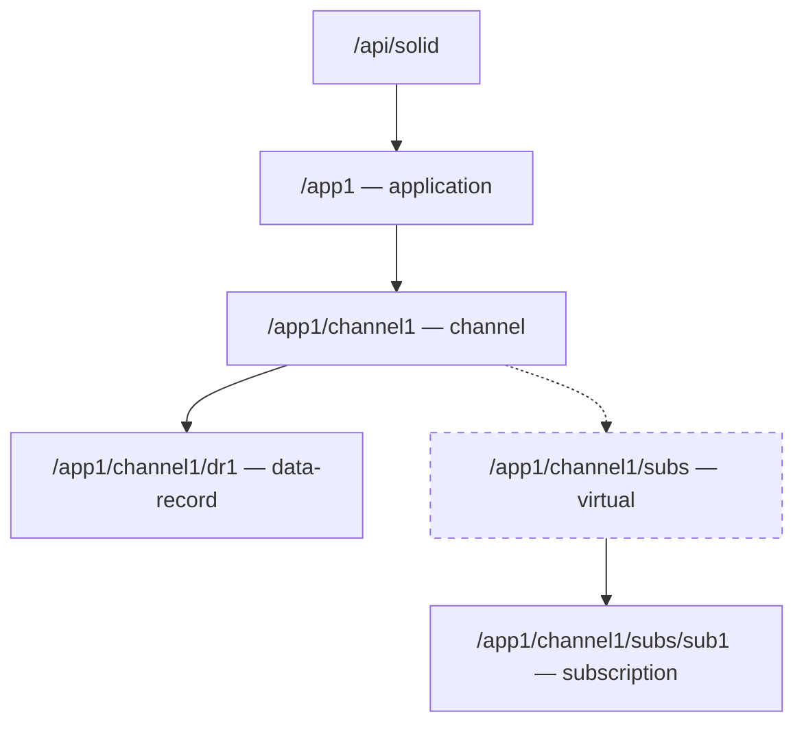

# Árvore de recursos e URIs

> **Modelo proposto**, não implementação concluída.

`subs` é um segmento de endereçamento **virtual, não persistido**. A criação do record e da subscrição é feita com `POST /api/solid/app1/channel1`, distinguida pelo campo `res-type`. A figura apresenta um exemplo mínimo, não a cardinalidade global completa.
