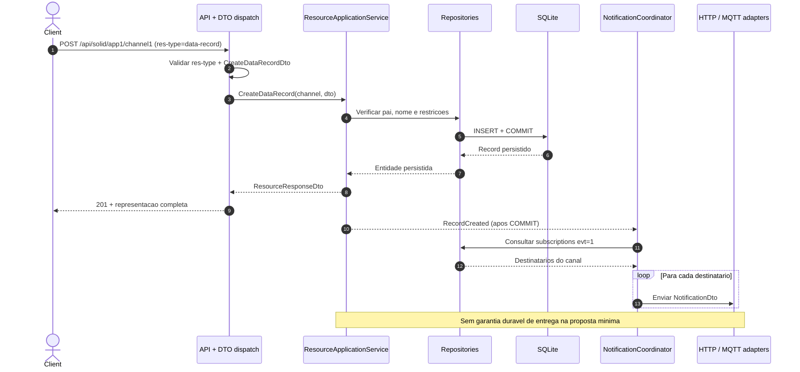

# 05 — Criação de data-record e notificação

**Estado: [PROPOSTA], não implementação.**

O `res-type` é um **discriminador** obrigatório no corpo JSON; não é sinal de que exista uma só entidade ou uma única classe DTO. O servidor escolhe o DTO específico a partir do envelope. A persistência precede a emissão do evento para evitar notificar dados que ainda não foram guardados. O momento da resposta HTTP face ao envio assíncrono deve ser definido/testado; aqui o envio é apresentado logicamente depois do commit, sem promessa de tempo real.
