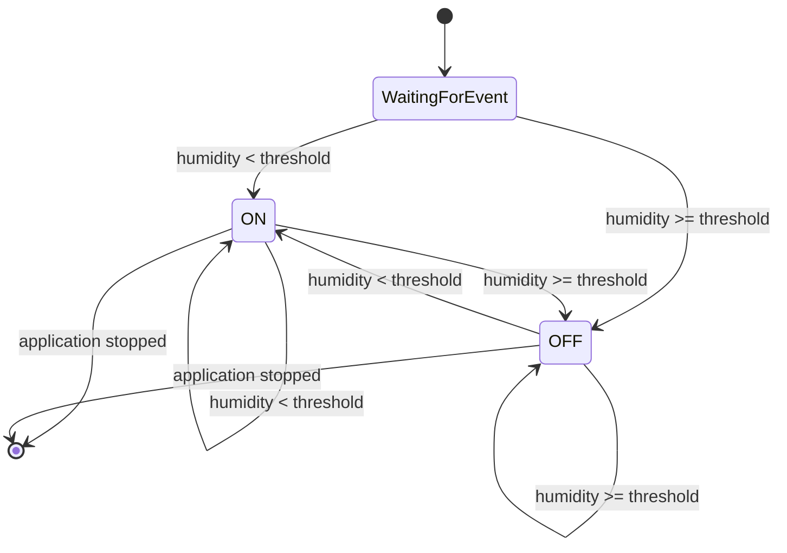

# Diagrama de estados da válvula

> **Modelo proposto**, não implementação concluída.

Estados e transições propostos. Uma notificação com payload inválido deve ser registada/assinalada sem fazer a transição para um estado baseado numa medição inexistente; a política exata deve ser decidida na implementação.
