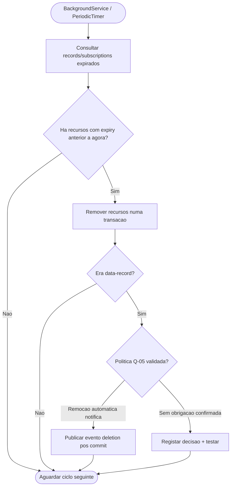

# 09 — Expiração e cascatas

**Estado: [PROPOSTA], não implementação.**

**[REQUISITO]** expiração automática de data-record/subscription; **[PROPOSTA]** worker dentro do middleware. O loop é de manutenção da BD, não detecção de medições na Valve. Remoção de records por expiração, por DELETE direto ou por cascata deve ter política de eventos definida em `19-politica-nomes-e-cascatas.md`.
