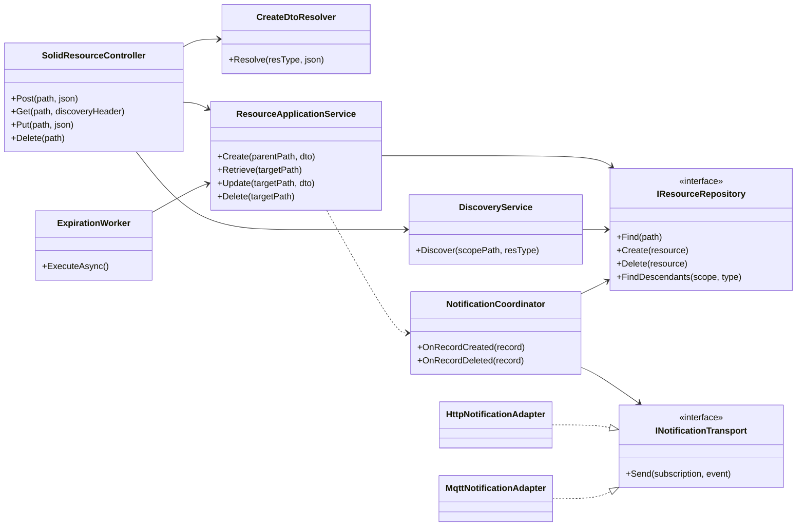

# 10 — Serviços e dependências (sem entidades de negócio)

**Estado: [PROPOSTA], não implementação.**

Este é um **diagrama de responsabilidades e dependências**, não de processos. Interfaces/repositórios são [PROPOSTA]; não é necessário implementar este número de classes literalmente. `ResourceApplicationService` valida regras; os adaptadores conhecem HTTP/MQTT mas não a regra de negócio da irrigação. `ExpirationWorker` pode invocar um caso de uso específico de remoção em vez de SQL direto, para evitar bypass às regras/eventos.
