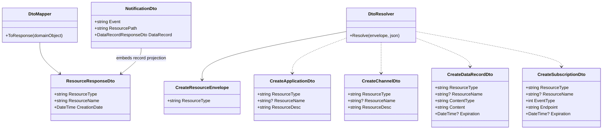

# 11 — DTOs, res-type e mapeamento JSON

**Estado: [PROPOSTA], não implementação.**

Este diagrama apresenta tipos *conceptuais*, não herança obrigatória. `CreateResourceEnvelope` serve apenas para ler `res-type`; o resolver deve validar tipo e **caminho do pai**. Os DTOs específicos têm campos diferentes. `ResourceResponseDto` simboliza uma **família** de DTOs de resposta que inclui todos os campos oficiais de cada recurso; não deve ser implementado como resposta incompleta. `NotificationDto` é [PROPOSTA], pois o enunciado não fixa as chaves do evento. Ver exemplos exatos em `../18-contratos-dto-e-mapeamento.md`.
