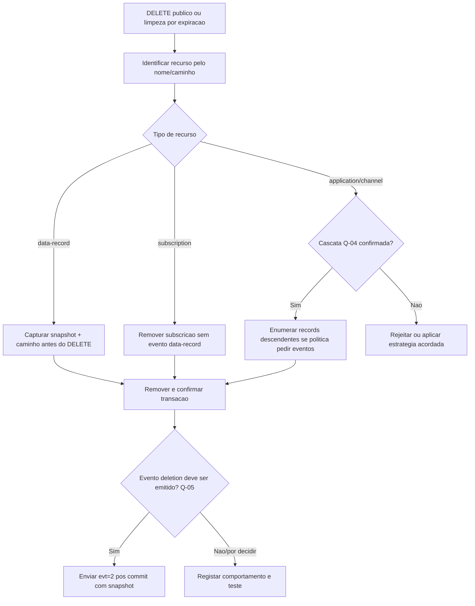

# 13 — Eliminação de recursos e eventos

**Estado: [PROPOSTA], não implementação.**

Eliminar um record requer preservar a representação completa **antes** de apagar, porque a notificação tem de incluir o recurso afetado. A existência de `ON DELETE CASCADE` na SQLite não gera automaticamente notificações externas; estas devem ser coordenadas pela aplicação se a política exigir. As questões Q-04/Q-05 continuam explícitas.
